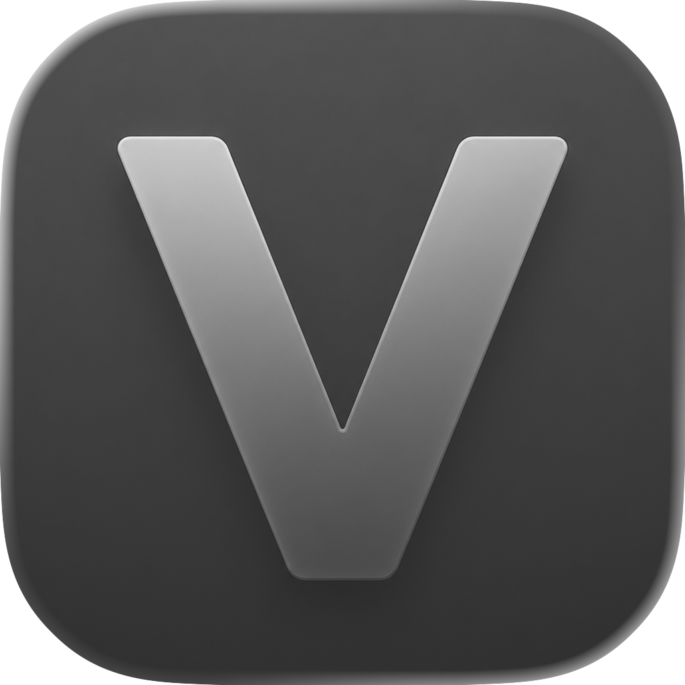

<p align="center">
    
</p>

<h1 align="center">Valen</h1>

<p align="center">
    <strong>A native macOS media player built with SwiftUI and powered by libmpv.<br/>
    Video-first controls, a compact mini-player mode, MKV support, subtitles, audio tracks, per-video resume state, and an MCP server for AI agent control.</strong>
</p>

<div align="center">
    <a href="https://github.com/junwatu/valen">
        
    </a>
    <a href="LICENSE">
        
    </a>
    
    
</div>

## Features

- Native SwiftUI macOS app
- mpv playback through `libmpv`
- MKV, WebM, MP4, MOV, AVI, FLAC, OGG, WAV, and common media extension support
- Open files with `Command-O`
- Drag and drop media files
- Compact QuickTime-style translucent overlay controls
- Responsive compact mode for small windows (single-row layout, 480×280 minimum)
- Overlay auto-hides during playback when the pointer is idle
- Cursor hides when playback controls hide
- Fullscreen support through shortcut, double-click, or macOS window controls
- Audio track selector
- Subtitle track selector
- Native Settings window
- Per-video saved state:
  - resume position
  - selected audio track
  - selected subtitle track
  - subtitles off/on state
  - volume
- MCP server (stdio + Unix socket) for AI agent control — ships inside the app bundle

## Shortcuts

| Shortcut | Action |
| --- | --- |
| `Command-O` | Open file |
| `Space` | Play / pause |
| `Left Arrow` | Seek backward |
| `Right Arrow` | Seek forward |
| `Control-Command-F` | Enter / exit fullscreen |
| `Escape` | Exit fullscreen |
| Double-click video | Enter / exit fullscreen |

The seek distance is configurable in `Valen > Settings`.

## Requirements

Install mpv through Homebrew:

```bash
brew install mpv
```

You also need Xcode or Xcode Command Line Tools with Swift 6.

## Run With Swift Package

```bash
swift run valen
```

This is the fastest development path.

## Run With Xcode

Open the native app target:

```bash
open Valen.xcodeproj
```

Or build from the command line:

```bash
xcodebuild -project Valen.xcodeproj -scheme Valen -configuration Debug build
```

The Xcode target uses the same Swift source files as the Swift Package target. It links against Homebrew `libmpv`.

## Test

Run the unit and layout-contract tests:

```bash
swift test
```

The tests cover time formatting, media track labels, supported media extensions, saved playback state, preference defaults, overlay behavior policy, MCP protocol encoding, release metadata, app bundle metadata, and stable UI copy/icons/metrics for the empty state and playback overlay.

See [Docs/Testing.md](Docs/Testing.md) for the test map and guidance on when to add more tests.

## Build Distributable App

```bash
Scripts/build-app.sh
```

This creates:

- `dist/Valen.app`
- `dist/Valen-0.2.0-macos-arm64.zip`

The generated app bundle includes `libmpv` and Homebrew runtime dylib dependencies under `Contents/Frameworks`.

By default, the bundle is ad-hoc signed for local use.


## Sparkle Updates

Sparkle update scaffolding is included, but Sparkle is not fully embedded yet.

Current files:

- `Packaging/Sources/mpvdesk/SparkleUpdater.swift`
- `Packaging/appcast.example.xml`

To include a Sparkle feed URL in the generated bundle:

```bash
SPARKLE_FEED_URL="https://your-domain.com/valen/appcast.xml" Scripts/build-app.sh
```

Before shipping auto-updates:

- embed Sparkle in the Xcode app target
- host a real `appcast.xml`
- replace the example feed URL
- sign release zips with Sparkle's EdDSA signing tool

## Rendering

Valen currently uses `NSOpenGLView` because mpv exposes a stable OpenGL render API. Apple deprecated OpenGL, so the long-term plan is to investigate a Metal-backed rendering surface.

See [Docs/Rendering.md](Docs/Rendering.md) for the rendering roadmap and Metal investigation checklist.

## Roadmap

See [Docs/Roadmap.md](Docs/Roadmap.md) for the subtitle-focused and AI-assisted playback TODO list.

## MCP Server

Valen ships with an embedded [Model Context Protocol](https://modelcontextprotocol.io) server so AI agents (Claude Code, Claude Desktop, etc.) can drive the player.

The `valen-mcp` executable reads JSON-RPC over stdio and forwards calls to the running GUI through a Unix domain socket. The GUI listens on `$TMPDIR/valen-control.sock` whenever the app is running.

### Tools

| Tool             | Args                      | Description                                   |
| ---------------- | ------------------------- | --------------------------------------------- |
| `play`           | -                         | Resume playback                               |
| `pause`          | -                         | Pause playback                                |
| `toggle_play_pause` | -                      | Toggle play/pause                             |
| `open_file`      | `path` (string)           | Open a local file by absolute path            |
| `seek`           | `seconds` (number)        | Seek relative to current position             |
| `set_volume`     | `value` (0-200)           | Set volume; 100 = unity, 200 = max            |
| `set_speed`      | `value` (>0)              | Set playback speed multiplier                 |
| `get_state`      | -                         | Return current `isPaused`, `volume`, `speed`, `position`, `duration`, `currentFile` |

### Build

```bash
swift build
```

The binaries land in `.build/debug/valen` and `.build/debug/valen-mcp`.

### Smoke test

Start the GUI once so the socket exists, then pipe JSON-RPC through the MCP binary:

```bash
.build/debug/valen &
printf '%s\n' \
  '{"jsonrpc":"2.0","id":1,"method":"initialize","params":{"protocolVersion":"2024-11-05","capabilities":{},"clientInfo":{"name":"smoke","version":"0.0.1"}}}' \
  '{"jsonrpc":"2.0","method":"notifications/initialized"}' \
  '{"jsonrpc":"2.0","id":2,"method":"tools/call","params":{"name":"get_state","arguments":{}}}' \
  | .build/debug/valen-mcp
```

### Claude Desktop

`valen-mcp` ships inside the app bundle at `Valen.app/Contents/MacOS/valen-mcp`. Add to `~/Library/Application Support/Claude/claude_desktop_config.json`:

```json
{
  "mcpServers": {
    "valen": {
      "command": "/Applications/Valen.app/Contents/MacOS/valen-mcp"
    }
  }
}
```

Launch Claude Desktop while the Valen app is running and the eight tools appear in the tools menu.


## Current Limitations

- OpenGL rendering works but produces deprecation warnings.
- Sparkle update code is scaffolded, but the framework still needs to be embedded in the Xcode target.

## License

Valen source code is licensed under the [MIT License](LICENSE).

Valen depends on `libmpv` and other bundled runtime libraries, which are distributed under their own licenses. Add `THIRD_PARTY_NOTICES.md` before a public binary release.
